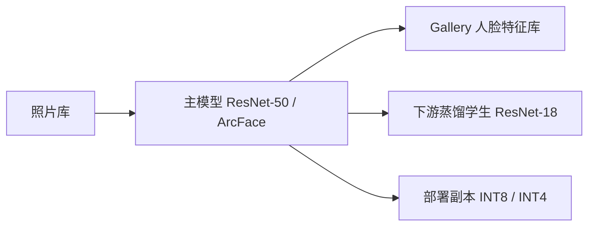

# Mini-Ever：用实验检验 T → D → M 锁链

Mini-Ever 是 AIAA2290 的小规模人脸识别与机器遗忘实验项目。项目计划在单张 RTX 4090 上搭建可控的数据与模型链，检验删除声明所需的三个条件：**可追踪性（Traceability）、可删除性（Deletability）和可测量的遗忘（Measurable forgetting）**。

> Deleting a record is an operation; forgetting a person is a claim — and a claim needs proof.

**当前状态：实验规划与仓库骨架已建立，训练、遗忘与评估代码尚未实现，尚无实测结果。** 本文根据《Mini-Ever 实验方案：用实验检验 T→D→M 锁链》（2026-11-23）整理。所有预期效果、算力预算及时间安排均为待检验的计划，不代表 Ever 或任何工业系统的真实表现。

## 研究问题

| 环节 | 问题 | 实验与主要产物 |
| --- | --- | --- |
| T：追踪 | 原始照片删了，影响还留在哪些节点？ | 实验 1：逐节点残留影响图 |
| D：删除 | 系统设计如何决定删除请求的成本？ | 实验 2：单体与 SISA 的成本—效用曲线 |
| M：验证 | 一次测试通过，是否足以支持遗忘声明？ | 实验 3：六种方法 × 五级测试矩阵 |
| 最弱环节 | 两环强、一环弱时，整体声明是否仍失败？ | 实验 4：四种系统配置的端到端泄露比较 |

核心假说是：删除声明的可信程度受到最弱环节约束，可用 `min(T, D, M)` 表达。它是待操作化和验证的框架，不是已证明的数值定律。

## 系统与比较基准



删除照片只改变第一个节点。实验将分别检查 gallery、主模型、下游学生和部署副本是否仍保留可检测的训练影响；下游蒸馏只使用不含遗忘用户的数据。

**遗忘基准是 never-trained 参照，而不是识别率为零。** 人脸模型可以泛化到未参与训练的身份，注册照片也可能使未训练过该身份的模型完成识别。因此，遗忘指标必须报告与“从训练数据中排除这些用户后重新训练”的参照之间的差距，同时保留原始测量值用于审计。

## 数据与模型计划

| 项目 | 方案 |
| --- | --- |
| 训练数据 | CelebA 对齐裁剪图；筛选至少 25 张照片的身份，目标约 1,000 人、2.5–3 万张，实际规模由筛选统计确认 |
| 身份内划分 | 70% 训练、10% gallery 注册照、20% 测试；保存固定划分与随机种子 |
| 遗忘集 | 每组随机 20 人，重复 3–5 组；同一身份的所有训练照片一起移除 |
| 参照模型 | 排除对应遗忘身份，以相同预训练初始化和训练协议重新训练，并使用多个随机种子 |
| 主模型 | ImageNet 预训练 ResNet-50、112×112 输入、512 维 embedding、ArcFace 损失 |
| 训练 | AdamW 或 SGD、余弦学习率、AMP、水平翻转与轻微裁剪，约 30–40 epoch；优化器及超参数需在运行前固定 |
| 效用 | 闭集 top-1、剩余用户 top-1、LFW 验证准确率；明确每项指标的身份集合和 gallery 协议 |
| 外部验证 | LFW 标准 6,000 对为起点，检查与 CelebA 的身份重叠；剔除后报告实际对数和修改后的协议 |
| 示踪标记 | 在部分遗忘训练照片上加入 Athena 式图案，测量固定目标身份的触发率及与参照的差距 |

参照模型也可能受预训练数据影响；本项目比较的是此次 CelebA 训练阶段的增量影响，不宣称模型从未在任何来源见过某个人。

## 实验 1：追踪删除后的残留影响

只从实验照片库移除遗忘用户的原始照片，保留其他产物。评估所需样本留在独立、受控的审计集合中，明确区分系统存储和审计数据。

| 节点 | 测量 |
| --- | --- |
| 照片库 | 删除后文件计数 |
| Gallery | 对新照片的 1:N 检索 top-1，与相同注册协议的参照比较 |
| 主模型 | U-LiRA 成员推断、示踪触发率 |
| 下游学生 | 蒸馏后成员推断与示踪触发率 |
| 部署副本 | 在实验 3 中检查量化后的残留影响 |

预期照片计数归零，但其他节点可能保留影响。蒸馏是否传递可检测的影响必须以实测结果判断。

## 实验 2：删除成本与系统设计

比较单体模型 `S=1` 与按用户分片的 `S=4/8/16` 设计。同一用户的全部照片必须位于同一分片；删除请求到达时仅重训受影响分片。初版从分片起点重训，后续可加入 SISA slicing 检查点。

- 原方案单体使用 ResNet-50，分片各使用 ResNet-18。该对比包含架构与容量差异；建议补充相同骨干的对照，避免把全部成本变化归因于分片。
- 各分片归一化 embedding 默认计划拼接；平均仅作为独立消融，不能默认不同模型的 embedding 坐标天然对齐。
- 模拟 20 个顺序到达的删除请求，逐次维护剩余训练集，记录每次 GPU 时间与累计时间。
- 分别报告局部模型更新成本与全链路成本，后者包括学生重蒸馏、gallery 更新和部署副本重新生成。
- 与采用相同分片、初始化、训练协议的 never-trained 参照比较；“精确重训”的有效性依赖这些条件，不能只凭一次 MIA 测试认定。

产物：删除 GPU 时间（对数横轴）与 LFW 准确率的权衡图，以及逐请求累计成本曲线。

## 实验 3：五级遗忘测试

比较输出过滤、保留集微调（FT）、NegGrad+、SCRUB、全量重训和 SISA 重训。前四种方法使用同一主模型起点；全量重训是独立参照，SISA 使用实验 2 的分片模型及匹配参照，不从单体权重直接转换。

| 级别 | 测试 | 重点 |
| --- | --- | --- |
| L1 | 原身份分类输出 | 区分输出屏蔽与参数变化；对齐参照的身份标签空间 |
| L2 | U-LiRA 成员推断 | 按样本估计 in/out 影子模型分布，报告攻击 AUC 等指标 |
| L3 | INT8 / INT4 后重复 L1、L2 | 记录量化后端、校准数据与支持情况；不支持应记 N/A |
| L4 | 少样本重新学习 | 按原计划每个遗忘身份 5 张照片、微调 50 步，比较完整恢复曲线 |
| L5 | 示踪标记触发 | 与未训练该标记的参照比较，报告干净输入上的效用 |

所有方法都报告剩余用户效用、LFW 表现与删除成本。输出过滤可能只改变 L1；近似方法在后续测试中可能暴露残留；重训方法预期更接近参照。这些均是研究假设，不预填通过/失败结果。

原方案把“通过”描述为与参照无显著差异。实施时需预先定义等效界值、置信区间、统计功效与多重比较处理；**未拒绝差异假设不等于证明等效**。证据不足时标记“不确定”，不强制归入“通过”。简化的 loss 攻击只能标记为探索性基线，不能称为完整 U-LiRA。

## 实验 4：检验最弱环节假说

| 配置 | 操作 | 待检验问题 |
| --- | --- | --- |
| A | 只删照片 | 其他节点是否仍保留可检测的影响？ |
| B | 主模型 SISA 重训，遗漏学生和 gallery | 主模型更新能否弥补追踪遗漏？ |
| C | 找到全部节点，仅采用近似遗忘 | 在多级测试下，近似更新是否充分？ |
| D | 完整追踪、SISA 重训、学生重蒸馏、gallery 清除、部署副本更新 | 全链路更新后是否接近匹配参照？ |

在明确的威胁模型下，以所有可访问产物中最大的攻击优势作为端到端泄露：

`L_end_to_end = max(L_gallery, L_main, L_student, L_deployment)`

如果每个产物的泄露已在同一尺度 `[0,1]` 上定义，且可信度定义为 `C_i = 1 - L_i`，则 `C_end_to_end = min(C_i)`。这解释了产物层面的最弱节点聚合；它并不自动证明 T、D、M 三个过程维度具有相同数值尺度。三环评分、攻击优势与参照差距的映射必须在出结果前确定，避免用结论反推评分。

产物：每个配置的节点泄露及区间、端到端结果，以及在评分规则成立时的平均值与最小值预测对照。

## 仓库结构

```text
aiaa2290-Mini-Ever/
├── README.md
├── configs/                  # 数据、模型、训练及实验配置模板
│   └── base.json
├── docs/
│   ├── protocol.md           # 对照、统计与可复现约定
│   ├── roadmap.md            # 排期、最小可行版与展示映射
│   └── references.md         # 原方案参考文献与核验状态
├── src/mini_ever/
│   ├── data/                 # 筛选、划分、身份去重、示踪
│   ├── models/               # ArcFace、gallery、蒸馏、量化
│   ├── unlearning/           # FT、NegGrad+、SCRUB、重训、SISA
│   └── evaluation/           # 效用、U-LiRA、L1–L5、端到端测量
├── experiments/              # 四组实验的入口规划
├── scripts/                  # 数据准备、批量运行与出图入口规划
├── tests/                    # 后续数据隔离、分片与指标测试
├── data/                     # 本地数据，内容不提交
└── results/                  # 仅公开汇总结果与不可识别图表
```

每个目录内有用途说明。`configs/base.json` 是规划模板，尚无训练程序消费它。当前没有可运行的训练命令；环境依赖将在实现与兼容性验证后固定。

## 开始使用

```bash
git clone https://github.com/NGC12-ZJH/aiaa2290-Mini-Ever.git
cd aiaa2290-Mini-Ever
```

先阅读 [实验协议](docs/protocol.md) 与 [实施路线](docs/roadmap.md)，再按授权渠道准备本地数据。优先实现数据划分、基线训练与 never-trained 参照，确认性能及实际耗时后再扩展遗忘方法。

## 公开范围与数据边界

遵循原方案，本仓库公开实验设计、后续代码、配置和汇总图表；不发布人脸原图、身份映射、逐人记录、embedding、gallery、训练权重或影子模型。原始 Word 文件不随仓库发布，概念已整理到本文。`.gitignore` 排除了常见数据与模型产物，但提交前仍需检查文件清单。

CelebA 的使用范围按原方案限定为非商业研究；下载与使用前应核对数据提供方的实际许可和条款。仓库暂未指定代码许可证，公开可见不等于已经授予开源再分发许可。

## 结果与引用

目前没有实验结果。预计单卡 GPU 总预算约 8–12 小时，属于原方案的数量级估计，需要用首轮训练和影子模型校准。无论结果是否支持预期，都应保留失败、负结果和不确定项。

参考文献及原方案的核验状态见 [references.md](docs/references.md)。本次仓库初始化未重新核验论文；视觉实验不能直接继承语言模型论文中的数值结论。
