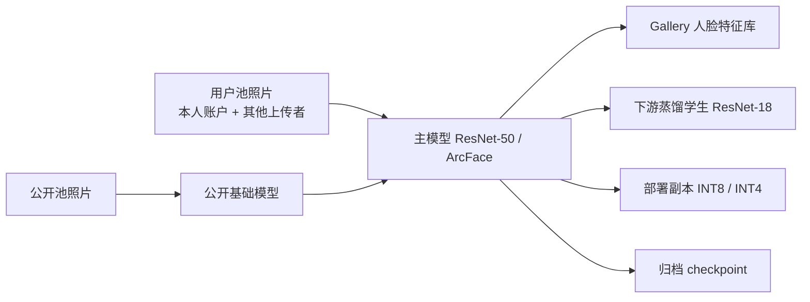

# Mini-Ever：用实验检验 T → D → M 锁链

Mini-Ever 是 AIAA2290 的小规模人脸识别与机器遗忘实验项目。项目计划在单张 RTX 4090 上搭建可控的数据与模型链，检验删除声明所需的三个条件：**可追踪性（Traceability）、可删除性（Deletability）和可测量的遗忘（Measurable forgetting）**。

> Deleting a record is an operation; forgetting a person is a claim — and a claim needs proof.

**当前状态：实验规划与仓库骨架已建立，训练、遗忘与评估代码尚未实现，尚无实测结果。** 本文根据《Mini-Ever 实验方案：用实验检验 T→D→M 锁链》（2026-11-23）整理。所有预期效果、算力预算及时间安排均为待检验的计划，不代表 Ever 或任何工业系统的真实表现。

## 研究问题

| 环节 | 问题 | 实验与主要产物 |
| --- | --- | --- |
| T：追踪 | 原始照片删了，影响还留在哪些节点？删除“账户”是否等于忘记“人”？ | 实验 1：逐节点残留影响图；账户删除与人物删除对比 |
| D：删除 | 系统设计如何决定删除请求的成本？ | 实验 2：单体与 SISA 的成本—效用曲线 |
| M：验证 | 一次测试通过，是否足以支持遗忘声明？ | 实验 3：六种方法 × 五级测试矩阵 |
| 最弱环节 | 两环强、一环弱时，整体声明是否仍失败？追踪只漏掉一小部分时会怎样？ | 实验 4：四种系统配置的端到端泄露比较；追踪遗漏率扫描 |

核心假说是：删除声明的可信程度受到最弱环节约束，可用 `min(T, D, M)` 表达。它是待操作化和验证的框架，不是已证明的数值定律。

## 设计依据：缩小版的 Ever

Mini-Ever 的数据与删除设定参照 FTC 对 Everalbum 案的认定（事实与出处见 [docs/everalbum_paravision.md](docs/everalbum_paravision.md)），目的是让实验问题对应真实系统中的删除难点，而不是复现 Ever 的模型：

| Ever 的真实情况（FTC 起诉书） | Mini-Ever 的对应设计 |
| --- | --- |
| 自研前先用公开技术；训练集由用户人脸与公开数据集**混合**构建（¶11–12） | 身份分为**公开池**与**用户池**；先用公开池训练基础模型，再加入用户池增强（两段式训练） |
| 删除承诺针对“停用账户的照片”；同一个人也会出现在他人上传的照片中 | 用户池每个身份的照片分配给**本人账户**与**其他上传者**；删除请求只删除本人账户的照片 |
| 4 代模型：2 代测试后弃用、1 代送 NIST 测试、1 代上线（¶14–16） | 节点清单包含**归档 checkpoint**，并记录每个产物版本包含哪些账户与身份 |
| 构建数据集时才排除已停用账户；地区判断依赖 IP 地址（¶12–15） | 实验 4 扫描**追踪遗漏率**，模拟筛选与追踪不完整 |
| 每个标注身份需有最少图片数（¶12） | 筛选至少 25 张照片的身份 |
| FTC 分别下令删除照片、face embeddings、模型与算法（命令 §III） | 照片库、gallery、主模型、学生与部署副本分别测量 |
| Paravision 以边缘 SDK 形式交付模型 | 部署副本以 INT8 / INT4 量化形式测量 |

Ever 的真实架构、训练规模与删除流程均未公开；以上对应只说明实验问题的来源，Mini-Ever 的结果不能直接推论 Ever 或 Paravision 的实际表现。

## 系统与比较基准



删除照片只改变照片库节点。实验将分别检查 gallery、主模型、下游学生、部署副本和归档 checkpoint 是否仍保留可检测的训练影响；下游蒸馏只使用不含遗忘用户的数据。公开基础模型不接触用户池，作为所有用户池删除操作共享的干净起点。

**遗忘基准是 never-trained 参照，而不是识别率为零。** 人脸模型可以泛化到未参与训练的身份，注册照片也可能使未训练过该身份的模型完成识别。因此，遗忘指标必须报告与“从训练数据中排除这些用户后重新训练”的参照之间的差距，同时保留原始测量值用于审计。

## 数据与模型计划

| 项目 | 方案 |
| --- | --- |
| 训练数据 | CelebA 对齐裁剪图；筛选至少 25 张照片的身份，目标约 1,000 人、2.5–3 万张，实际规模由筛选统计确认 |
| 身份池 | 按身份随机划分：约 40% 为**公开池**（永不作为遗忘对象），约 60% 为**用户池**；比例在运行前固定 |
| 身份内划分 | 70% 训练、10% gallery 注册照、20% 测试；保存固定划分与随机种子 |
| 上传账户 | 用户池每个身份的训练照片约 60% 归属**本人账户**，其余约 40% 归属 2 个**其他上传者**账户。其他上传者为虚拟账户，不对应池内身份，避免一次删除连带改变他人数据 |
| 遗忘集 | 每组从用户池随机抽 20 人，重复 3–5 组。两种删除单位：**账户删除**（只删本人账户上传的照片，即 Ever 的承诺范围）与**人物删除**（删除该身份全部训练照片） |
| 参照模型 | 从同一公开基础模型出发、以相同协议重新进行第二阶段训练，并使用多个随机种子。**人物参照**排除遗忘身份全部照片；**账户参照**只排除本人账户照片，用于确认账户删除是否执行正确 |
| 主模型 | ImageNet 预训练 ResNet-50、112×112 输入、512 维 embedding、ArcFace 损失；禁止使用人脸数据集预训练权重（见实验 0） |
| 训练 | 两段式：① 公开池训练基础模型，只训练一次并共享；② 在公开池 + 用户池上继续训练得到主模型。AdamW 或 SGD、余弦学习率、AMP、水平翻转与轻微裁剪，总计约 30–40 epoch；两阶段的轮数分配、优化器及超参数需在运行前固定 |
| 效用 | 闭集 top-1、剩余用户 top-1、LFW 验证准确率；明确每项指标的身份集合和 gallery 协议 |
| 外部验证 | LFW 标准 6,000 对为起点，检查与 CelebA 的身份重叠；剔除后报告实际对数和修改后的协议 |
| 示踪标记 | 在部分遗忘训练照片上加入 Athena 式图案，测量固定目标身份的触发率及与参照的差距 |

参照模型也可能受预训练数据影响；本项目比较的是此次 CelebA 用户池训练阶段的增量影响，不宣称模型从未在任何来源见过某个人。两段式训练还使每个参照只需重跑第二阶段，降低多种子参照与影子模型的成本；实际节省需以首轮计时确认。

## 实验 0：起点检查——模型事先认识这些人吗？

CelebA 都是名人，人脸模型的预训练数据大多也是名人。如果起点模型事先就“认识”遗忘组的人，后续测到的删除残留会被低估。本实验在任何用户池训练开始前完成，作为其余实验的前提条件。

**权重来源规定**：只允许使用 ImageNet 预训练权重或随机初始化。**禁止**使用任何在人脸数据集（如 MS-Celeb-1M、VGGFace2、Glint360K、WebFace、CASIA-WebFace）上训练过的权重。记录权重的来源、版本与哈希。

| 被检查的模型 | 比较 | 预期 |
| --- | --- | --- |
| ImageNet 起点（未做人脸训练） | 遗忘组 vs 用户池其他身份 | 两组表现相同，整体识别能力很弱 |
| 公开基础模型（只见过公开池） | 遗忘组 vs 用户池其他身份 | 两组表现相同：都没见过，只能靠泛化 |
| 公开基础模型（阳性对照） | 公开池身份 vs 用户池身份 | 公开池明显更好，证明这项测量能识别出“见过”的身份 |

- 测量：用各模型提取的 embedding，在测试照片上做 1:1 验证（TAR@FAR，或同人与异人对的相似度差）和 1:N 检索 top-1；同时报告遗忘组与对照组的差值及置信区间。
- 判定：遗忘组与对照组的差值落在预先登记的等效界值内，记为“通过”；否则记为“不确定”，检查身份抽样与数据泄漏，必要时重新抽取遗忘组。阳性对照测不出差异时，说明测量灵敏度不足，需要先改进测量再继续。
- 本实验只需前向推理，不增加训练开销。

即使起点模型有少量事先知识，也会同时存在于主模型和人物参照中，在比较时相互抵消；本实验的作用是确认这种事先知识足够小，不会造成“天花板效应”而压低残留测量。

## 实验 1：追踪删除后的残留影响

只从实验照片库移除遗忘用户的原始照片，保留其他产物。评估所需样本留在独立、受控的审计集合中，明确区分系统存储和审计数据。

| 节点 | 测量 |
| --- | --- |
| 照片库 | 删除后文件计数 |
| Gallery | 对新照片的 1:N 检索 top-1，与相同注册协议的参照比较 |
| 主模型 | U-LiRA 成员推断、示踪触发率 |
| 下游学生 | 蒸馏后成员推断与示踪触发率 |
| 部署副本 | 在实验 3 中检查量化后的残留影响 |
| 归档 checkpoint | 删除前保存的主模型版本；只做清单登记，不另行训练 |

预期照片计数归零，但其他节点可能保留影响。蒸馏是否传递可检测的影响必须以实测结果判断。

### 1b：账户删除 ≠ 忘记人物

Ever 承诺删除的是“停用账户的照片”，而一个人的脸也会出现在别人上传的照片里。本组比较同一遗忘组的两种删除单位，并都使用精确重训，排除遗忘方法本身的误差：

| 条件 | 从第二阶段训练中移除 | 对照参照 |
| --- | --- | --- |
| 账户删除 | 仅本人账户上传的照片（约 60%） | 账户参照（检查执行正确）、人物参照（检查与“忘记此人”的差距） |
| 人物删除 | 该身份的全部训练照片 | 人物参照 |

主要测量：在审计集合的新照片上，Gallery 1:N 检索与主模型 U-LiRA 相对人物参照的差距。账户删除后若仍显著高于人物参照，说明“按账户删除”在定义上就达不到“忘记此人”，这一缺口不能靠更好的遗忘算法弥补。结论方向不预设：其他上传者的照片较少时，残留也可能很小。

### 产物版本清单

每个产物（基础模型、主模型、学生、部署副本、gallery、归档 checkpoint）记录训练或生成时包含的账户与身份集合及其哈希。删除请求到达后，以清单列出所有受影响的产物版本。这对应 Ever 多代模型并存的情况：没有版本清单，就无法回答“删除是否覆盖了所有副本”。

## 实验 2：删除成本与系统设计

比较单体模型 `S=1` 与按用户分片的 `S=4/8/16` 设计。同一用户的全部照片必须位于同一分片；删除请求到达时仅重训受影响分片。初版从分片起点重训，后续可加入 SISA slicing 检查点。

- 分片只划分用户池，按身份分配（同一身份的本人账户与其他上传者照片位于同一分片），各分片从共享的公开基础模型出发训练；公开池是否加入每个分片的训练需在运行前固定。
- 原方案单体使用 ResNet-50，分片各使用 ResNet-18。该对比包含架构与容量差异；建议补充相同骨干的对照，避免把全部成本变化归因于分片。
- 各分片归一化 embedding 默认计划拼接；平均仅作为独立消融，不能默认不同模型的 embedding 坐标天然对齐。
- 模拟 20 个顺序到达的删除请求，逐次维护剩余训练集，记录每次 GPU 时间与累计时间。
- 分别报告局部模型更新成本与全链路成本，后者包括学生重蒸馏、gallery 更新和部署副本重新生成。
- 与采用相同分片、初始化、训练协议的 never-trained 参照比较；“精确重训”的有效性依赖这些条件，不能只凭一次 MIA 测试认定。

产物：删除 GPU 时间（对数横轴）与 LFW 准确率的权衡图，以及逐请求累计成本曲线。

## 实验 3：五级遗忘测试

比较输出过滤、保留集微调（FT）、NegGrad+、SCRUB、全量重训和 SISA 重训。前四种方法使用同一主模型起点；全量重训是独立参照，SISA 使用实验 2 的分片模型及匹配参照，不从单体权重直接转换。

| 级别 | 测试 | 重点 |
| --- | --- | --- |
| L1 | 原身份分类输出 | 区分输出屏蔽与参数变化；对齐参照的身份标签空间 |
| L2 | U-LiRA 成员推断 | 按样本估计 in/out 影子模型分布，报告攻击 AUC 等指标 |
| L3 | INT8 / INT4 后重复 L1、L2 | 记录量化后端、校准数据与支持情况；不支持应记 N/A |
| L4 | 少样本重新学习 | 按原计划每个遗忘身份 5 张照片、微调 50 步，比较完整恢复曲线 |
| L5 | 示踪标记触发 | 与未训练该标记的参照比较，报告干净输入上的效用 |

所有方法都报告剩余用户效用、LFW 表现与删除成本。输出过滤可能只改变 L1；近似方法在后续测试中可能暴露残留；重训方法预期更接近参照。这些均是研究假设，不预填通过/失败结果。

原方案把“通过”描述为与参照无显著差异。实施时需预先定义等效界值、置信区间、统计功效与多重比较处理；**未拒绝差异假设不等于证明等效**。证据不足时标记“不确定”，不强制归入“通过”。简化的 loss 攻击只能标记为探索性基线，不能称为完整 U-LiRA。

## 实验 4：检验最弱环节假说

| 配置 | 操作 | 待检验问题 |
| --- | --- | --- |
| A | 只删照片 | 其他节点是否仍保留可检测的影响？ |
| B | 主模型 SISA 重训，遗漏学生和 gallery | 主模型更新能否弥补追踪遗漏？ |
| C | 找到全部节点，仅采用近似遗忘 | 在多级测试下，近似更新是否充分？ |
| D | 完整追踪、SISA 重训、学生重蒸馏、gallery 清除、部署副本更新 | 全链路更新后是否接近匹配参照？ |

在明确的威胁模型下，以所有可访问产物中最大的攻击优势作为端到端泄露：

`L_end_to_end = max(L_gallery, L_main, L_student, L_deployment)`

如果每个产物的泄露已在同一尺度 `[0,1]` 上定义，且可信度定义为 `C_i = 1 - L_i`，则 `C_end_to_end = min(C_i)`。这解释了产物层面的最弱节点聚合；它并不自动证明 T、D、M 三个过程维度具有相同数值尺度。三环评分、攻击优势与参照差距的映射必须在出结果前确定，避免用结论反推评分。

产物：每个配置的节点泄露及区间、端到端结果，以及在评分规则成立时的平均值与最小值预测对照。

### 4b：追踪遗漏率扫描

A–D 只给出四个离散点。本组在配置 D（其余环节全部做到）的基础上，只让 T 环变得不完整：遗忘身份的训练照片中，按比例 `r` 随机保留一部分未被找到，其余照片移除后精确重训主模型并更新下游产物。

- `r ∈ {0, 5%, 20%, 40%}`。`r = 0` 即配置 D；`r ≈ 40%` 与实验 1b 的账户删除遗漏数量相当，区别在于 4b 随机遗漏、1b 遗漏的是其他上传者的照片，两者可互相核对。
- 每个 `r` 的遗漏照片按固定种子抽样，与遗忘组、训练种子一起记录。
- 测量与实验 4 相同的节点泄露及端到端泄露，并报告相对人物参照的差距及区间。

产物：`r` → 端到端泄露曲线。若曲线在很小的 `r` 处就明显偏离参照，支持“一环不完整即足以破坏整体声明”；若近似线性或在大 `r` 前都接近参照，同样如实报告，并据此修正最弱环节假说的表述。

## 仓库结构

```text
aiaa2290-Mini-Ever/
├── README.md
├── configs/                  # 数据、模型、训练及实验配置模板
│   └── base.json
├── docs/
│   ├── overview.md           # 通俗版说明：设计、三环对应与预期结果
│   ├── protocol.md           # 对照、统计与可复现约定
│   ├── roadmap.md            # 排期、最小可行版与展示映射
│   ├── references.md         # 原方案参考文献与核验状态
│   └── everalbum_paravision.md  # Ever 案例事实与出处（设计依据）
├── src/mini_ever/
│   ├── data/                 # 筛选、划分、身份去重、示踪
│   ├── models/               # ArcFace、gallery、蒸馏、量化
│   ├── unlearning/           # FT、NegGrad+、SCRUB、重训、SISA
│   └── evaluation/           # 效用、U-LiRA、L1–L5、端到端测量
├── experiments/              # 四组实验的入口规划
├── scripts/                  # 数据准备、批量运行与出图入口规划
├── tests/                    # 后续数据隔离、分片与指标测试
├── data/                     # 本地数据，内容不提交
└── results/                  # 仅公开汇总结果与不可识别图表
```

每个目录内有用途说明。`configs/base.json` 是规划模板，尚无训练程序消费它。当前没有可运行的训练命令；环境依赖将在实现与兼容性验证后固定。

## 开始使用

```bash
git clone https://github.com/NGC12-ZJH/aiaa2290-Mini-Ever.git
cd aiaa2290-Mini-Ever
```

想快速了解项目，先看 [通俗版说明](docs/overview.md)。实施前阅读 [实验协议](docs/protocol.md) 与 [实施路线](docs/roadmap.md)，再按授权渠道准备本地数据。优先实现数据划分、基线训练与 never-trained 参照，确认性能及实际耗时后再扩展遗忘方法。

## 公开范围与数据边界

遵循原方案，本仓库公开实验设计、后续代码、配置和汇总图表；不发布人脸原图、身份映射、逐人记录、embedding、gallery、训练权重或影子模型。原始 Word 文件不随仓库发布，概念已整理到本文。`.gitignore` 排除了常见数据与模型产物，但提交前仍需检查文件清单。

CelebA 的使用范围按原方案限定为非商业研究；下载与使用前应核对数据提供方的实际许可和条款。仓库暂未指定代码许可证，公开可见不等于已经授予开源再分发许可。

## 结果与引用

目前没有实验结果。预计单卡 GPU 总预算约 8–12 小时，属于原方案的数量级估计，需要用首轮训练和影子模型校准。无论结果是否支持预期，都应保留失败、负结果和不确定项。

参考文献及原方案的核验状态见 [references.md](docs/references.md)。本次仓库初始化未重新核验论文；视觉实验不能直接继承语言模型论文中的数值结论。
